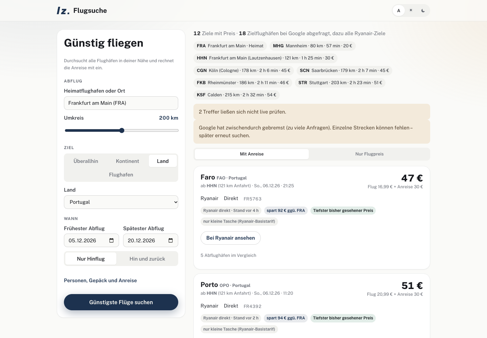

# lz-flugsuche

Findet den günstigsten Flug – nicht nur ab dem Heimatflughafen, sondern ab **allen Flughäfen im Umkreis**, und rechnet die **Anreise** mit ein. Ziel kann ein Flughafen, ein **Land**, ein **Kontinent** oder **überallhin** sein.



## Was es anders macht

| Problem bei üblichen Portalen | Lösung hier |
|---|---|
| Nahe Flughäfen nur mit starrem Radius, Anreise zählt nicht | Jeder Abflughafen im Umkreis wird durchsucht; sortiert wird nach **Flugpreis + Anreise** (km × €/km, Hin- und Rückweg) mit Fahrzeit |
| „Überallhin“ nur ab einem Flughafen | Ryanair-Ziele ab **jedem** Abflughafen, Google-Preise für den Hauptflughafen jedes Landes; die günstigsten Ziele werden ab allen Abflughäfen nachgefragt |
| Kalender- und Kartenpreise sind veraltet | Die besten Treffer werden **live** nachgeprüft; Ryanair-Preise zeigen ihren Stand |
| Billigflieger fehlen | Ryanair wird direkt abgefragt, Buchungslink geht zur Airline |
| Endpreis ohne Gepäck | Gepäckwahl fließt in Google-Preise ein; bei Ryanair-Basistarifen steht „Gepäck kommt dazu“ |
| Sponsored-Treffer | Keine Werbung, keine Provision, Sortierung nur nach Preis |
| Man weiß nicht, was durchsucht wurde | Abflughäfen und Anzahl der abgefragten Ziele stehen über der Liste |

Jeder gefundene Preis wird lokal gespeichert (`~/.lz-flugsuche/preise.sqlite`); die Karte zeigt, ob er der tiefste bisher gesehene ist.

Grundlage ist eine eigene Recherche (11/2026): Preise steigen nicht durch wiederholtes Suchen, sondern weil Buchungsklassen ausverkaufen und Portale alte Cache-Preise zeigen. VPN bringt ab der EU praktisch nichts.

## Herunterladen

Fertige Programme für Windows, macOS (Apple Silicon und Intel) und Linux liegen unter [Releases](../../releases/latest). Doppelklick startet die App und öffnet die Oberfläche im Browser; ist kein Tab mehr offen, beendet sie sich nach drei Minuten von selbst.

- **macOS:** Die App ist nicht von Apple beglaubigt. Beim ersten Start Rechtsklick → *Öffnen*, oder im Terminal `xattr -dr com.apple.quarantine /Applications/LZ-Flugsuche.app`.
- **Windows:** SmartScreen meldet einen unbekannten Herausgeber → *Weitere Informationen* → *Trotzdem ausführen*.
- **Linux:** Archiv entpacken, `./LZ-Flugsuche` starten.

## Aus dem Quellcode starten

```bash
python3.12 -m venv .venv
.venv/bin/pip install -e ".[test]"
.venv/bin/lzflug server          # http://127.0.0.1:4201
```

Kommandozeile:

```bash
.venv/bin/lzflug suche FRA --ziel PT --von 2027-01-10 --bis 2027-01-31 --naechte 4
.venv/bin/lzflug suche FRA --ziel kontinent:EU --radius 250
.venv/bin/lzflug suche FRA --ziel ueberall --personen 2 --gepaeck handgepaeck
```

## Ablauf einer Suche

1. **Abflughäfen:** Heimatflughafen plus bis zu 7 weitere im Umkreis (mittlere und große Flughäfen mit Linienverkehr). Straßenkilometer = Luftlinie × 1,3.
2. **Grobsuche:** Google-Preiskalender (günstigster Preis je Tag im Zeitraum) vom Heimatflughafen zu jedem Zielkandidaten, dazu Ryanair „überallhin“ ab jedem Abflughafen.
3. **Ausweiten:** Die 8 günstigsten Ziele werden ab allen anderen Abflughäfen im Kalender abgefragt.
4. **Live-Prüfung:** Die besten Google-Kalenderpreise werden mit einer echten Suche nachgeprüft (Uhrzeit, Airline, Umstiege, Selbst-Umstieg).
5. **Bewertung:** Gesamt = Flug + Anreise; „spart X €“ vergleicht mit dem Heimatflughafen.

Zwischenergebnisse erscheinen in der Oberfläche schon während der Suche.

## Datenquellen

| Quelle | Wie | Grenzen |
|---|---|---|
| Google Flights | Bibliothek [`fli`](https://github.com/punitarani/fli) (PyPI `flights`), inoffiziell | Google bremst bei vielen Anfragen (HTTP 429); hier höchstens 2 gleichzeitig, bei 429 20 s Pause. Kann bei Formatänderungen ausfallen |
| Ryanair | `farfnd/v4` oneWayFares / roundTripFares, inoffiziell | Basistarif ohne Gepäck, Preis pro Person × Anzahl |
| Flughäfen | [OurAirports](https://ourairports.com/data/) (gemeinfrei) → `lzflug/data/airports.json` | Aktualisieren: `python scripts/airports_update.py` |

Nicht angebunden (Stand 11/2026): Amadeus Self-Service ist abgeschaltet, Kiwi Tequila und Skyscanner nur für Partner. Wizz Air und easyJet erscheinen über Google.

Die Abfragen sind für den privaten Gebrauch gedacht: wenige, gedrosselte Anfragen, keine Umgehung von Schutzmaßnahmen.

## Rechtliches

- lz-flugsuche ist ein privates, nicht kommerzielles Werkzeug. Es steht in keiner Verbindung zu Google, Ryanair oder anderen Airlines; deren Namen und Marken gehören den jeweiligen Inhabern.
- Die Preise kommen aus **inoffiziellen, öffentlich erreichbaren Schnittstellen**, die auch die Websites selbst nutzen. Es werden keine Anmeldungen, Bezahlschranken oder Schutzmaßnahmen umgangen, die Abfragen sind gedrosselt. Die Nutzungsbedingungen der Anbieter gelten für jeden, der das Programm benutzt – wer es einsetzt, ist für deren Einhaltung selbst verantwortlich. Gewerbliche Nutzung, Weiterverkauf von Daten oder ein Betrieb als Dienst für andere sind nicht vorgesehen und laut [LICENSE](LICENSE) untersagt.
- Gebucht wird immer direkt bei Airline oder Portal; lz-flugsuche verkauft nichts und erhält keine Provision.
- Alle Preise ohne Gewähr. Verbindlich ist allein der Preis beim Anbieter im Buchungsschritt.
- Drittanbieter-Lizenzen: Public Sans (SIL OFL 1.1), Flughafendaten von OurAirports (gemeinfrei), Python-Bibliotheken unter ihren eigenen Lizenzen; die Liste liegt jedem Release als `THIRD-PARTY-LICENSES.txt` bei.

## Release

Tag `v*` setzen und pushen – `.github/workflows/release.yml` baut auf Windows, macOS (arm64 und x64) und Linux (x64 und arm64) mit PyInstaller (`packaging/build.py`, lokal genauso aufrufbar), prüft, dass jede Plattform da ist, hängt alles ans Release und schreibt die Version zurück nach `main`.

## Entwicklung

```bash
.venv/bin/pytest -q
```

| Pfad | Inhalt |
|---|---|
| `lzflug/search.py` | Suchablauf und Bewertung |
| `lzflug/sources/` | Google und Ryanair |
| `lzflug/airports.py` | Umkreis, Länder, Kontinente, Namenssuche |
| `lzflug/server.py` | FastAPI, Suche als Hintergrundauftrag mit Fortschritt |
| `lzflug/static/` | Oberfläche (LZM-Web-Stil, hell und dunkel) |
| `lzflug/app.py` | Einstieg der gepackten App (Browser öffnen, Leerlauf-Ende) |
| `packaging/build.py` | PyInstaller-Bau für alle Plattformen |

## Noch offen

- Preisalarm für ein ganzes Suchprofil (Mail/Telegram)
- Bahn als Anreise (Preis und Fahrzeit) statt nur Auto-Kilometer
- Flexible Nächte-Spanne (heute: feste Anzahl)
- Weitere Billigflieger direkt (Wizz Air, easyJet)
